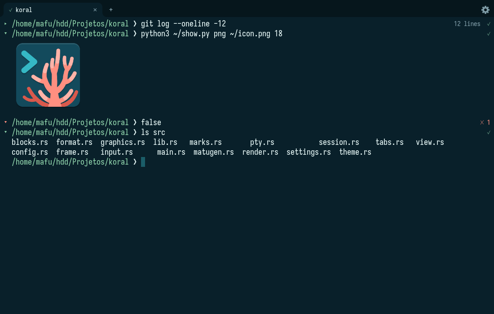

# Koral

A Rust terminal with native sharky shell support. It understands
[sharky](https://github.com/mafuzyk/sharky-shell) commands as units: each one can
fold, shows its status and duration, and can be copied or jumped to on its own.
Tabs are native, with no tmux involved.



Koral runs on Linux under Wayland and is developed on Hyprland.

## Install

```sh
yay -S koral-bin
```

To build from source:

```sh
cargo build --release
./target/release/koral
```

The default font is IosevkaTerm Nerd Font Mono.

## Shortcuts

| Keys | Action |
| --- | --- |
| `ctrl+shift+t` | New tab |
| `ctrl+shift+w` | Close tab |
| `ctrl+tab`, `ctrl+shift+tab` | Next and previous tab |
| `alt+1` to `alt+9` | Go to a tab |
| `ctrl+shift+c`, `ctrl+shift+v` | Copy and paste |
| `ctrl+shift+z`, `ctrl+shift+x` | Previous and next prompt |
| `ctrl+shift+f` | Fold or open a command |
| `ctrl+shift+g` | Copy a command's output |
| `shift+pageup`, `shift+pagedown` | Scroll a page |
| `ctrl+shift+,` | Settings |

Click the marker to the left of a command to fold it. Selecting text copies it to
the primary selection, and the middle button pastes it.

## Configuration

Use the gear in the tab strip, or edit `~/.config/koral/config.koral`:

```
polyp font "IosevkaTerm Nerd Font Mono"
polyp font_size 13.5
polyp opacity 0.8
polyp padding 8
polyp shell /usr/bin/sharky
polyp matugen on
```

With `matugen on`, Koral adds its template to your matugen config and takes its
colours from the next wallpaper change.

## Without sharky

Koral starts sharky when it finds it, and `$SHELL` otherwise. Any shell works as a
plain terminal with tabs, images and video. Folds, status and prompt jumps need
the marks sharky prints.

## Images and video

Koral speaks the kitty graphics protocol, so `mpv --vo=kitty` and other programs
that use it work.

## Licence

GPL-3.0-only. See [LICENSE](LICENSE).
