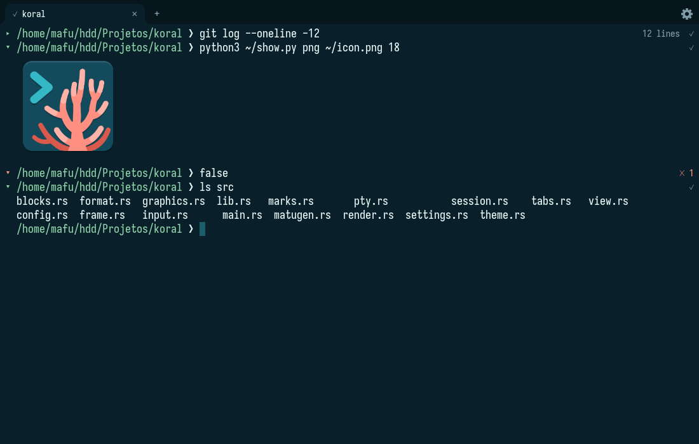

# Koral

A Rust terminal with native sharky shell support. It understands
[sharky](https://github.com/mafuzyk/sharky-shell) commands as units: each one can
fold, shows its status and duration, and can be copied or jumped to on its own.
Tabs are native, with no tmux involved.



Koral runs on Linux under Wayland and is developed on Hyprland.

## Install

```sh
yay -S koral-bin
```

To build from source (edition 2024, Rust >= 1.88):

```sh
cargo build --release
./target/release/koral
```

With Nix: `nix run .` builds and starts Koral, `nix build .#` builds it in the store.

The default font is IosevkaTerm Nerd Font Mono. The settings tab lists the fixed-width fonts on your system and built-in colour themes. A font that is missing or proportional is replaced by a fixed-width one, and the settings tab says so.

## Shortcuts

| Keys | Action |
| --- | --- |
| `ctrl+shift+t` | New tab |
| `ctrl+shift+w` | Close tab |
| `ctrl+tab`, `ctrl+shift+tab` | Next and previous tab |
| `alt+1` to `alt+9` | Go to a tab |
| `ctrl+shift+d` | Split pane right |
| `ctrl+shift+e` | Split pane down |
| `ctrl+shift+q` | Close pane |
| `ctrl+shift+left/right/up/down` | Focus adjacent pane |
| `ctrl+alt+shift+left/right/up/down` | Resize pane divider |
| `ctrl+shift+c`, `ctrl+shift+v` | Copy and paste |
| `ctrl+shift+z`, `ctrl+shift+x` | Previous and next prompt |
| `ctrl+shift+f` | Fold or open a command |
| `ctrl+shift+g` | Copy a command's output |
| `ctrl+shift+s` | Search the scrollback |
| `ctrl+=`, `ctrl+-`, also with `shift`; `ctrl+shift+0` | Zoom in, out and back |
| `shift+pageup`, `shift+pagedown` | Scroll a page |
| `ctrl+shift+,` | Settings tab |

Click the marker to the left of a command to fold it. Drag pane dividers or click a pane to focus it. Selecting text copies it to
the primary selection, and the middle button pastes it. Double-click selects a
word, triple-click a line, and `ctrl+alt` with a drag a block.

In the search bar, Enter (or `up`/`down`) steps through matches with an `N/M` counter, `shift+enter` goes downward, and
Esc closes it. Lowercase queries ignore case.

Hold `ctrl` over a link or local file path (`path/to/file.rs:42`) to see its real target, and `ctrl`+click to open it. When a
program uses the mouse, `ctrl+shift`+click opens it. Only `http`, `https`, `mailto`
and `file` links open, through `xdg-open`.

## Configuration

Use the gear in the tab strip (`ctrl+shift+,`) to open the Settings tab, or edit `~/.config/koral/config.sharky` (changes reload automatically):

```
polyp theme "catppuccin-mocha"
polyp font "IosevkaTerm Nerd Font Mono"
polyp font_size 13.5
polyp font_weight 500
polyp bold_weight 800
polyp bold_italic_weight 900
polyp italic_style oblique
polyp opacity 0.8
polyp padding 8
polyp scrollback 10000
polyp clipboard_read off
polyp shell /usr/bin/sharky
polyp matugen off
bind ctrl+shift+n new_tab
bind ctrl+shift+t unbind
```

Built-in themes (`koral`, `sharky`, `terminal`, `dracula`, `catppuccin-mocha`, `catppuccin-macchiato`, `catppuccin-frappe`, `catppuccin-latte`, `tokyo-night`, `gruvbox-dark`, `nord`, `rose-pine`, `one-dark`, `solarized-dark`) can be selected in the Settings tab with a live preview palette or set with `polyp theme`. `font_weight` goes from 100 to 900, `scrollback` from `0` to `1000000`, `clipboard_read` controls OSC 52 clipboard reads, and `bind <shortcut> <action>` overrides or unbinds shortcuts. With `polyp theme sharky` (default), colours come from `theme.sharky`.

With `matugen on`, Koral adds its template to your matugen config and takes its
colours from the next wallpaper change.

## CLI & Remote Control

```sh
koral --cwd ~/projects --title work --class dev.koral -e fish
koral ctl split right
koral ctl focus left
koral ctl new-tab --title logs --cwd /var/log -e tail -f syslog
koral ctl set-theme dracula
koral ctl open-settings
koral ctl list
```

Running terminals listen on `$KORAL_SOCKET` (`$XDG_RUNTIME_DIR/koral-<pid>.sock`) with `0600` permissions.

## Without sharky

The shell comes from `$KORAL_SHELL`, then the `shell` config key, then sharky if found on
`PATH`, then `$SHELL`. Any shell works as a plain terminal with tabs, search, links, images
and video. Folds, status and prompt jumps need the marks sharky prints.

## Images and video

Koral speaks the kitty graphics protocol, so `mpv --vo=kitty` and other programs
that use it work.

Programs can set the tab title, ring the bell and send desktop notifications with
`OSC 777` or `OSC 9`. Notifications need `libnotify`, and links need `xdg-utils`.

## Licence

GPL-3.0-only. See [LICENSE](LICENSE).
