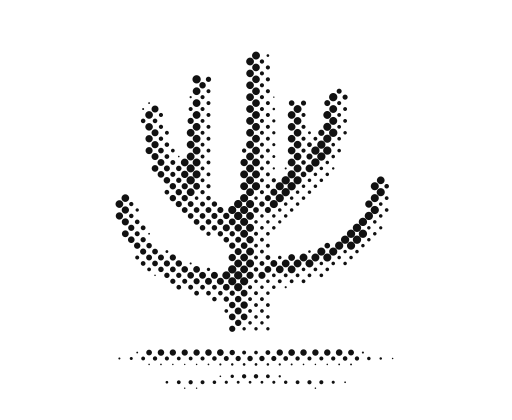
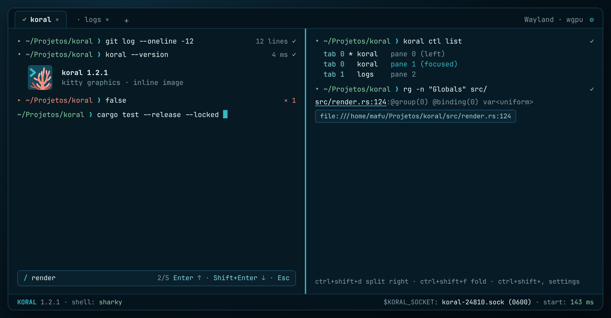
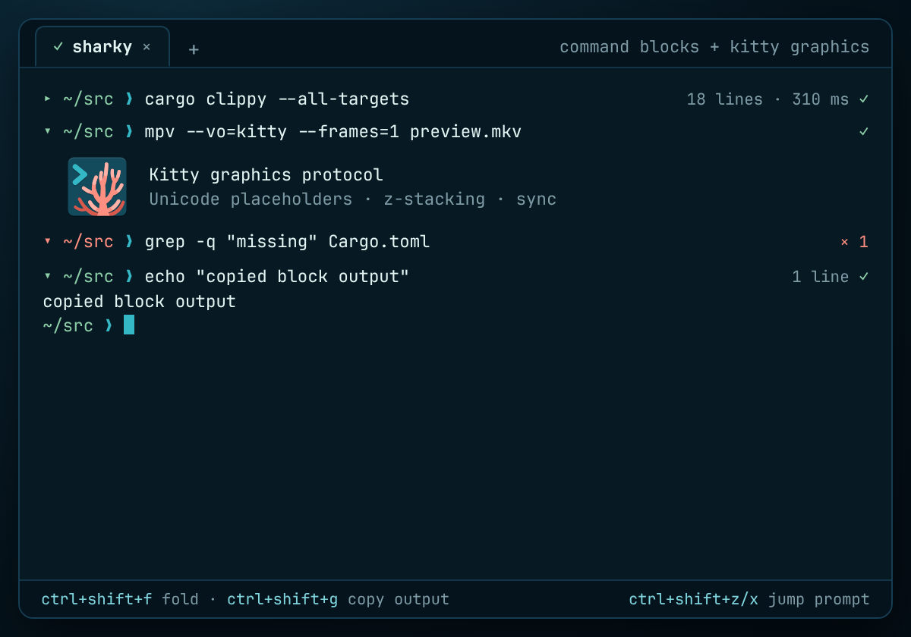
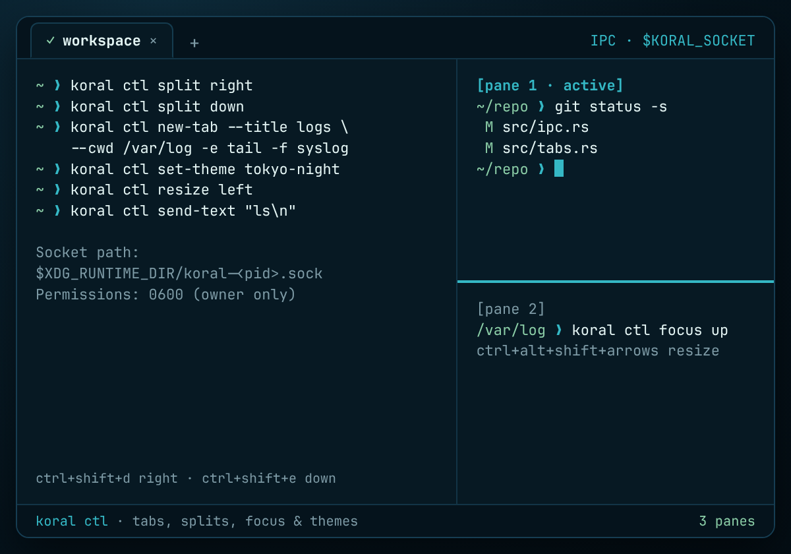
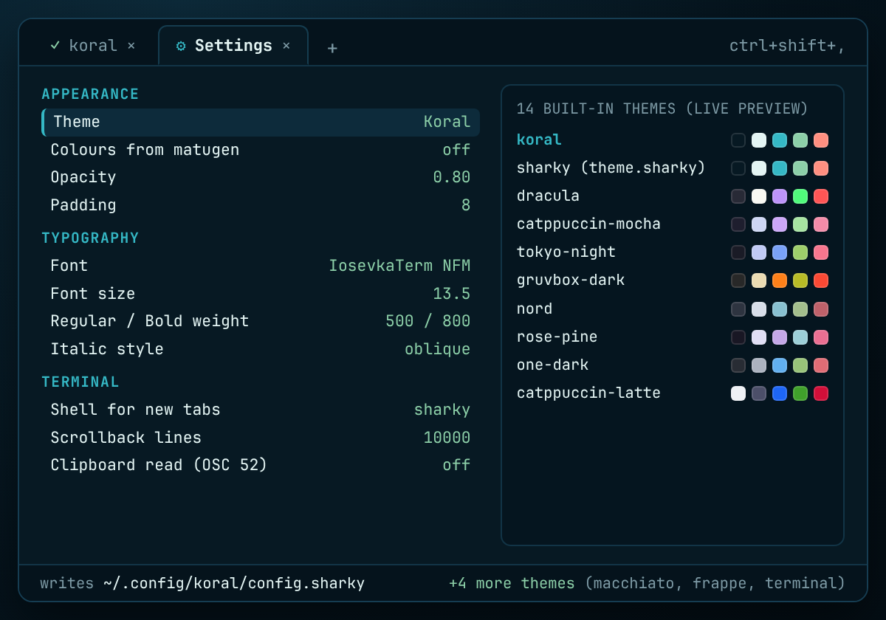
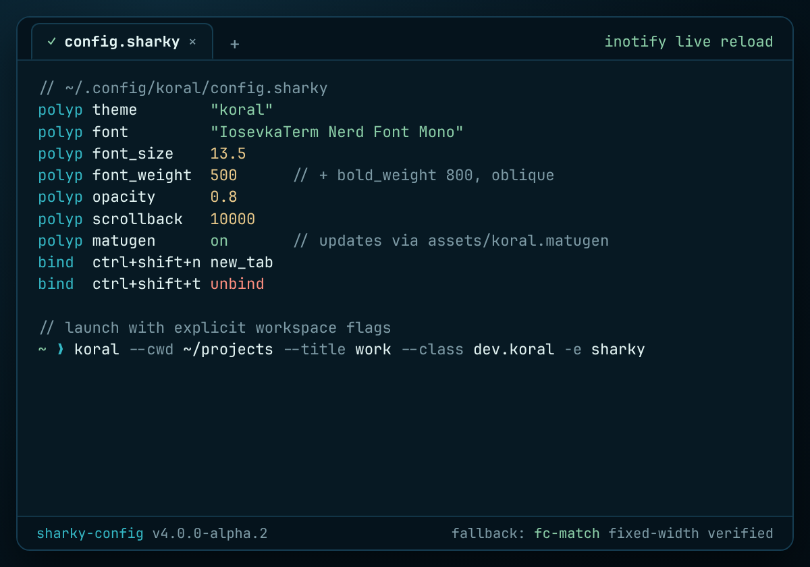

<div align="center">

<picture>
  <source media="(prefers-color-scheme: dark)" srcset="assets/brand/koral-mark-inverse.svg" />
  
</picture>

<h1>koral</h1>

<p><strong>A shell-agnostic Linux terminal emulator (Wayland &amp; X11) with native <a href="https://github.com/mafuzyk/sharky-shell">sharky</a> support.</strong></p>

<p>
  Foldable command blocks, native tabs and split panes, 14 built-in themes, Kitty graphics, and live Settings — rendered on the GPU with <code>wgpu</code>.
</p>

<p>
  <a href="https://github.com/mafuzyk/koral/releases"></a>
  <a href="https://github.com/mafuzyk/koral/actions/workflows/release.yml"></a>
  <a href="https://aur.archlinux.org/packages/koral-bin"></a>
  <a href="LICENSE"></a>
</p>



<p><em>Foldable command blocks, inline Kitty graphics, split panes, smart-case scrollback search, and clickable file paths (v1.2.1)</em></p>

</div>

---

<h2 align="center">Installation</h2>

```sh
# Arch Linux (prebuilt binary on AUR)
paru -S koral-bin

# NixOS / Nix flakes
nix run github:mafuzyk/koral

# Prebuilt Linux x86_64 tarball
curl -fsSLO https://github.com/mafuzyk/koral/releases/latest/download/koral-x86_64-linux.tar.gz
tar -xzf koral-x86_64-linux.tar.gz
install -Dm755 koral ~/.local/bin/koral
```

> [!NOTE]
> `koral` targets Linux on Wayland and X11 (`x86_64`), with `--class` setting both Wayland `app_id` and X11 `WM_CLASS`. Any POSIX/interactive shell works out of the box, with native support for `sharky` and standard OSC 133/7 prompt marks.

<details>
<summary>Nix flake outputs, building from source, and optional runtime dependencies</summary>

### Nix flake

`koral-bin` is the `default` package (`nix run .` or `nix build .#`); build directly from source with:

```sh
nix build .#koral
```

Both outputs wrap `koral` with `libnotify`, `xdg-utils`, `fontconfig`, `libxkbcommon`, `wayland`, `vulkan-loader`, and `libGL`.

### Build from source

Requires Rust >= 1.88 (`edition = 2024`):

```sh
cargo build --release --locked
./target/release/koral
```

### Runtime & optional dependencies

- **Default font:** `IosevkaTerm Nerd Font Mono` (missing or proportional fonts fall back automatically to a fixed-width system font via `fontconfig`, and the Settings tab reports the fallback).
- **Desktop notifications (`OSC 777` / `OSC 9`):** `libnotify`.
- **Opening clicked links and file paths:** `xdg-utils` (`xdg-open`).
- **Command-block integration:** works with [`sharky`](https://github.com/mafuzyk/sharky-shell) (`sharky-shell-bin` / `sharky-shell-git`) or any shell emitting `OSC 133` / `OSC 7`.

</details>

---

<h2 align="center">Benches</h2>

Historical results collected on 2026-11-22 with an earlier version of
[`scripts/bench.sh`](scripts/bench.sh): Linux 7.2.15-zen1, Wayland session on
Hyprland 0.57.1, AMD Ryzen 5 5600GT with Radeon Vega graphics, 1920x1080 @
60 Hz. The old harness did not isolate configuration consistently or prove
that injected keys reached the PTY. These figures are not evidence of clean
cross-terminal performance or input latency.

For new runs, `--config NONE` uses an empty XDG config directory for each
run and passes kitty's explicit `--config NONE` flag. Version reporting and
measurements use the same resolved executable. A latency sample is invalid
unless the process inside the PTY confirms the expected input. This method
measures synthetic input to frame capture, not physical input-to-photon latency.
The payload is a freshly generated 100,000,000-byte base64 file.
The script refuses to start on the real desktop session; use an isolated
virtual monitor (for example `WAYLAND_DISPLAY=wayland-koral-bench`) or pass
`--allow-real-desktop` deliberately. The JSON report records the effective
`wayland_display` and `display` targets under `environment.system`.

The suite was previously exercised with
`scripts/bench.sh --terminals koral,ghostty,alacritty,kitty --runs 5 --config NONE --json /tmp/bench.json`.
The table below contains **historical 1.2.1 data with mixed provenance**: `kitty 0.50.0` was
measured on 2026-11-22 in a preliminary run while `koral 1.2.1` comes from an older
release baseline and was **not** re-measured alongside it.

| Benchmark | kitty `0.50.0` (historical, 2026-11-22) | koral `1.2.1` (historical, mixed provenance) |
| --- | ---: | ---: |
| Cold launch-to-shell | 283 ms (3-run median) | 143 ms |
| 100 MB `cat` to PTY | 5 ms (shell-side clock) | 1,684 ms |
| Peak RSS (`VmHWM`) | 134,400 KiB / 131.25 MiB | 240 MiB |
| Colored TUI frame throughput | 426.04 frames/s | not measured |
| Historical synthetic-key figure (unverified) | 153.433 ms (one sample per run) | not measured |

<details>
<summary>Reproduce & raw 3-run observations</summary>

```sh
scripts/bench.sh --terminals koral,ghostty,alacritty,kitty --runs 5 --config NONE --json /tmp/bench.json
```

Kitty `0.50.0 created by Kovid Goyal`, three consecutive runs from
`/tmp/bench-baseline-current.json` (launch ms, cat ms, VmHWM KiB, TUI frames/s,
latency p50 ms):

- `356`, `4`, `134400`, `411.00`, `140.873`
- `283`, `5`, `134120`, `427.89`, `153.433`
- `270`, `6`, `134560`, `426.04`, `161.049`
- medians: `283 ms`, `5 ms`, `134400 KiB`, `426.04 fps`, `153.433 ms`

The `cat` figure is measured by `date +%s%N` inside the spawned shell, so it
excludes terminal rendering that continues after the producer finishes; treat
it as producer time, not end-to-end scroll completion. Latency p50/p99 above
come from one synthetic key per run and are intentionally reported as raw
single samples. `scripts/bench-latency.py` uses `grim` screencopy capture and
Hyprland's native key-state Lua dispatcher; see its module docstring for the
full methodology and its `--self-test` option for percentile checks.

</details>

---

<h2 align="center">Screenshots</h2>

<div align="center">

<table>
  <tr>
    <td align="center" width="50%">
      
      <br />
      <sub><b>Foldable command blocks &amp; Kitty graphics</b></sub>
    </td>
    <td align="center" width="50%">
      
      <br />
      <sub><b>Native split panes &amp; <code>koral ctl</code> IPC</b></sub>
    </td>
  </tr>
  <tr>
    <td align="center" width="50%">
      
      <br />
      <sub><b>Live Settings tab &amp; 14 built-in themes</b></sub>
    </td>
    <td align="center" width="50%">
      
      <br />
      <sub><b>Declarative <code>koral.conf</code>, keybinds &amp; CLI flags</b></sub>
    </td>
  </tr>
</table>

</div>

---

## Command blocks & shell integration

`koral` treats each command as a structured unit rather than undifferentiated scrollback text, with built-in `OSC 133` / `OSC 7` integration for `bash`, `zsh`, `fish`, and `sharky`:

- **Foldable blocks:** click the marker beside any command or press `ctrl+shift+f` to collapse/expand long output with an automatic folded line count.
- **Status & duration:** every block displays completion status (`✓` / `× <code>`) and elapsed duration on the right.
- **Prompt navigation & output capture:** jump cleanly between commands (`ctrl+shift+z` / `ctrl+shift+x`) or copy an entire command's output (`ctrl+shift+g`).
- **Zero rc-file edits:** `shell_integration on` (default) injects `bash` (`--rcfile`), `zsh` (`ZDOTDIR`), and `fish` (`XDG_DATA_DIRS`) hooks from a private runtime directory without modifying your dotfiles. Shell resolution follows `$KORAL_SHELL` → `shell` in `koral.conf` → `sharky` on `PATH` → `$SHELL`.

---

## Tabs, splits & remote control

First-class tabs and split panes without `tmux`, paired with scriptable Unix socket control:

- **Launch flags:** `koral [--cwd|--working-directory PATH] [--title TEXT] [--class|--app-id ID] [-e|--command COMMAND [ARGS...]]`
- **Remote control (`koral ctl`):** every window listens on `$KORAL_SOCKET` (`$XDG_RUNTIME_DIR/koral-<pid>.sock`, `0600` permissions):

```sh
koral ctl new-tab --title logs --cwd /var/log -e tail -f syslog
koral ctl split right            # also: down | horizontal | vertical
koral ctl focus left             # also: right | up | down
koral ctl resize left            # also: right | up | down
koral ctl set-theme dracula
koral ctl send-text "git status\n"
koral ctl open-settings
koral ctl reload
koral ctl list [--json]
```

- **Navigation, search & links:** `ctrl+shift+s` opens smart-case scrollback search (`Enter`/`Up`/`Down` step matches with an `N/M` counter, `Shift+Enter` steps down, lowercase queries ignore case). Hold `ctrl` over URLs or local paths (`path/to/file.rs:42`) to preview their resolved target and click to open via `xdg-open` (`ctrl+shift+click` when mouse reporting is active; restricted to `http`, `https`, `mailto`, and `file`).
- **Mouse selection:** drag copies to primary selection (`middle-click` pastes), double-click selects a word, triple-click selects a line, and `ctrl+alt+drag` selects a rectangular block.

<details>
<summary>Default keybindings and rebindable action names</summary>

### Default shortcuts

| Keys | Action | Action ID (`bind`) |
| --- | --- | --- |
| `ctrl+shift+t` | New tab | `new_tab` |
| `ctrl+shift+w` | Close tab | `close_tab` |
| `ctrl+tab`, `ctrl+shift+tab` | Next / previous tab | `next_tab`, `prev_tab` |
| `alt+1` .. `alt+9` | Switch to tab 1–9 | `tab_1` .. `tab_9` |
| `ctrl+shift+d` | Split pane right | `split_right` |
| `ctrl+shift+e` | Split pane down | `split_down` |
| `ctrl+shift+q` | Close active pane | `close_pane` |
| `ctrl+shift+left/right/up/down` | Focus adjacent pane | `focus_left/right/up/down` |
| `ctrl+alt+shift+left/right/up/down` | Resize pane divider | `resize_left/right/up/down` |
| `ctrl+shift+c`, `ctrl+shift+v` | Copy / paste | `copy`, `paste` |
| `ctrl+shift+z`, `ctrl+shift+x` | Previous / next prompt | `prev_prompt`, `next_prompt` |
| `ctrl+shift+f` | Fold or expand command block | `toggle_fold` |
| `ctrl+shift+g` | Copy command output | `copy_output` |
| `ctrl+shift+s` | Search scrollback | `search` |
| `ctrl+=` / `ctrl+-` (also with `shift`), `ctrl+shift+0` | Zoom in / out / reset | `zoom_in`, `zoom_out`, `zoom_reset` |
| `shift+pageup`, `shift+pagedown` | Scroll one page | `page_up`, `page_down` |
| `ctrl+shift+,` | Open Settings tab | `settings` (`open_settings`) |

Pass `none` or `unbind` in `keybind <shortcut>=unbind` to disable a default shortcut. Click pane dividers to drag-resize or click any pane to focus it.

</details>

---

## Settings, themes & configuration

Open the interactive **Settings tab** (`ctrl+shift+,` or click the `⚙` icon in the tab bar) to inspect fixed-width system fonts, preview all 14 themes live, and persist changes directly to `~/.config/koral/koral.conf`. Edits to `~/.config/koral/koral.conf` are watched with `inotify` and reload automatically. Existing `config.sharky` / `config.koral` files are converted once to `koral.conf` on startup and left untouched:

```conf
# ~/.config/koral/koral.conf
theme koral                             # or sharky, dracula, catppuccin-mocha, ...
font IosevkaTerm Nerd Font Mono
font_size 13.5
font_weight 500
bold_weight 800
bold_italic_weight 900
italic_style oblique
ligatures on
# font_features +zero +ss01
opacity 0.8
padding 8
scrollback 10000
clipboard_read off
clipboard_write ask
notifications allow
shell /usr/bin/bash
shell_integration on
matugen off
window_decorations off
present_mode auto
keybind ctrl+shift+n=new_tab
keybind ctrl+shift+t=unbind
```

- **14 built-in themes:** `koral`, `sharky` (reads `~/.config/sharky/theme.sharky`), `terminal`, `dracula`, `catppuccin-mocha`, `catppuccin-macchiato`, `catppuccin-frappe`, `catppuccin-latte`, `tokyo-night`, `gruvbox-dark`, `nord`, `rose-pine`, `one-dark`, and `solarized-dark`.
- **Matugen sync:** `matugen on` installs [`assets/koral.matugen`](assets/koral.matugen) into your matugen configuration and updates colours dynamically on wallpaper changes.

---

## Graphics, notifications & stack

- **Kitty graphics protocol:** supports inline images, animations/video via `mpv --vo=kitty`, Unicode placeholders (`c=`, `r=`), `z`-index layering, and synchronized updates without screen tearing or lost image anchors.
- **Terminfo (`xterm-koral`):** ships [`assets/xterm-koral.terminfo`](assets/xterm-koral.terminfo); run `koral +terminfo install` to compile it into `~/.terminfo`. `koral` sets `TERM=xterm-koral` only when the entry is installed locally and falls back to `xterm-256color` otherwise (over SSH, remote hosts lacking `xterm-koral` need the entry copied or `TERM=xterm-256color`).
- **Desktop integration:** handles `OSC 777` and `OSC 9` for window titles, terminal bell, and desktop notifications, `OSC 9;4` tab progress bars, and `OSC 22` pointer cursor shapes, plus [`assets/koral.desktop`](assets/koral.desktop) and [`assets/koral.svg`](assets/koral.svg).
- **Architecture:** pure Rust over `winit`, `wgpu`, `glyphon`, and `alacritty_terminal`.

---

## License

Released under the [GNU General Public License v3.0 only](LICENSE) (`GPL-3.0-only`).
